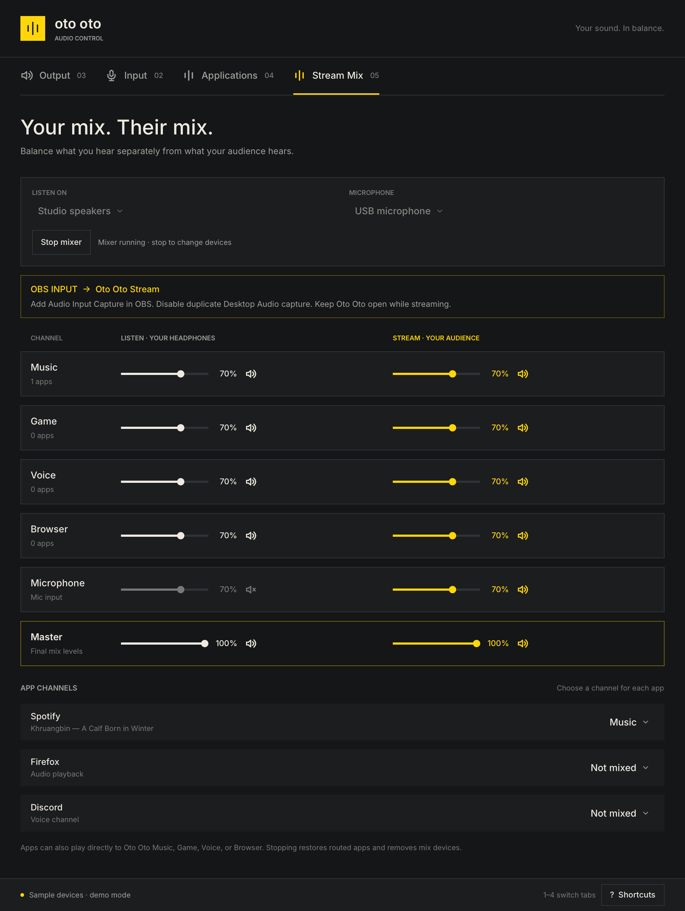

# Oto Oto


A native Linux audio mixer in Rust, built with [Anomaly's Rune](https://github.com/anomalyco/rune). Choose outputs and microphones, adjust device and per-stream volume, mute, change ports, and route playing or recording apps to another device. **Stream Mix** adds separate listening and broadcast mixes, with a virtual input for OBS and other recording software.

Works with PipeWire through `pipewire-pulse`, or with PulseAudio. Uses `pactl`; it does not edit audio configuration files. Devices, streams, and external volume changes refresh about every two seconds. Audio commands run off the UI thread and report failures in the window.

## Stream Mix



1. Open **Stream Mix** (`4`). Choose your listening output, preferably headphones, and optionally a microphone.
2. Click **Start mixer**. Oto Oto creates Music, Game, Voice, Browser, and Microphone channels.
3. Under **App channels**, assign playing apps to Music, Game, Voice, or Browser. Apps can also select **Oto Oto Music**, **Oto Oto Game**, **Oto Oto Voice**, or **Oto Oto Browser** as their own output device.
4. Set each channel's **Listen** and **Stream** faders and mute buttons independently. Listen controls your headphones; Stream controls the audience's audio. Each mix also has a master fader and mute.
5. In OBS, add **Audio Input Capture → Oto Oto Stream**. Disable duplicate Desktop Audio and separate mic capture if they would capture the same sounds twice. The mix runs at 48 kHz.

Microphone monitoring starts muted, while its Stream feed is enabled. Selecting **No microphone** avoids opening a mic. The system's default input/output and microphone hardware gain are preserved. App volume in the Applications tab still affects both mixes before the channel faders.

Keep Oto Oto open for the streaming session. **Stop mixer**, quitting, or losing the UI connection restores assigned apps to their previous outputs when available, then removes the mix devices. Apps routed directly into channels return to the previous default output. Stop before changing the listening device or microphone. Levels are retained across Stop/Start within the current app session; profiles and app-assignment rules are not saved across app restarts. Returning apps that recreate their audio streams need to be assigned again, unless they select a virtual channel themselves.

The graph uses PulseAudio-compatible null-sink, loopback, and remap-source modules. It was verified on PipeWire's PulseAudio server; standalone PulseAudio uses the same module interface but has not been tested here. A pipe-owned helper cleans up after UI crashes; session tokens prevent cleanup from unloading unrelated modules after an audio-server restart. Only one mixer session may run per user. Disconnecting a selected device or losing a mix connection stops the session and reports an error. Effects, VST hosting, signal meters, and linked faders are outside this version's scope.

## Build and run

Install a current stable Rust toolchain, the Wayland and XKB libraries, a Vulkan driver, and `pactl`:

```sh
# Arch / Omarchy (with an existing working PipeWire setup)
sudo pacman -S --needed rust git pkgconf wayland libxkbcommon libxkbcommon-x11 libpulse

# Debian / Ubuntu (with an existing working audio server)
sudo apt install build-essential git pkg-config libwayland-dev libxkbcommon-dev libxkbcommon-x11-0 mesa-vulkan-drivers pulseaudio-utils

bin/build
./target/release/oto-oto
```

Rune is pre-release and pinned to a specific commit; `Cargo.lock` pins transitive dependencies. First builds download and compile the renderer and can take several minutes. Wayland and X11 are supported. The app needs a working Vulkan driver (hardware or Mesa software rendering).

Install the binary, icon, and launcher entry for the current user:

```sh
bin/install
```

Open **Oto Oto** from the desktop launcher, or run `~/.local/bin/oto-oto`. `PREFIX` overrides the default `~/.local` install location. For an Arch package, run `bin/package` from the project root, then install the resulting package with `pacman -U`.

On Omarchy the accent follows the current theme within two seconds, including theme symlink replacements. On other desktops it defaults to yellow. No desktop settings are changed.

## Controls

| Key | Action |
| --- | --- |
| `1`, `2`, `3`, `4` | Output, Input, Applications, Stream Mix |
| `M` / `Space` | Mute the default output (or input on the Input tab) |
| `+`, `-` | Adjust the default volume by 5% |
| `Tab`, `Shift+Tab` | Move focus |
| Arrows / Home / End | Adjust a focused slider |
| `R` | Refresh / reconnect |
| `?` / `Escape` | Show / close shortcuts |
| `Q` | Quit |

Volume controls range from 0–100%; existing amplification above 100% is displayed, but new changes are capped at 100%. A dragged volume is applied on release; Escape cancels the drag. Setting a default changes the device for new streams. Use Applications to move existing streams. Monitor sources are hidden from microphone devices. Each application stream gets its own controls, so an app with several streams can appear more than once.

Device port menus appear when a device has several usable ports. Card profile changes, equalizers, Bluetooth pairing, and live signal metering are outside this version's scope. Interface text is currently English.

## Inspect and verify

```sh
./target/release/oto-oto status             # Real audio state as JSON; no display needed
./target/release/oto-oto --demo             # Interactive sample devices; no audio changes
./target/release/oto-oto --snap docs/output.png
./target/release/oto-oto --scene apps --snap docs/apps.png
./target/release/oto-oto --scene stream-live --size 940x1250 --snap docs/stream.png
bin/test
# Optional live-server signal tests (pactl, pacat, parec, Python 3 required):
python3 tests/stream_audio.py target/release/oto-oto
```

Rune's headless rendering and scripted input automatically use isolated sample devices and never run audio commands. Scenes include `output`, `input`, `apps`, `stream`, `stream-live`, `empty`, and `error`. Tests exercise JSON parsing, command argument construction, controls, routing, drag cancellation, stale backend updates, and the independent mix controls. The opt-in signal test uses generated tones and virtual microphone/output devices; it never opens a hardware microphone or sends tones to hardware speakers. It checks mix isolation, channel/master mutes, mic capture, route restoration, lost connections, session exclusivity, EOF cleanup, partial-start rollback, and preservation of system defaults.

If the app cannot connect, verify that `pactl info` works in the same user session and that PipeWire's PulseAudio service or PulseAudio is running. Errors stay visible until dismissed; Retry requests a fresh snapshot.
