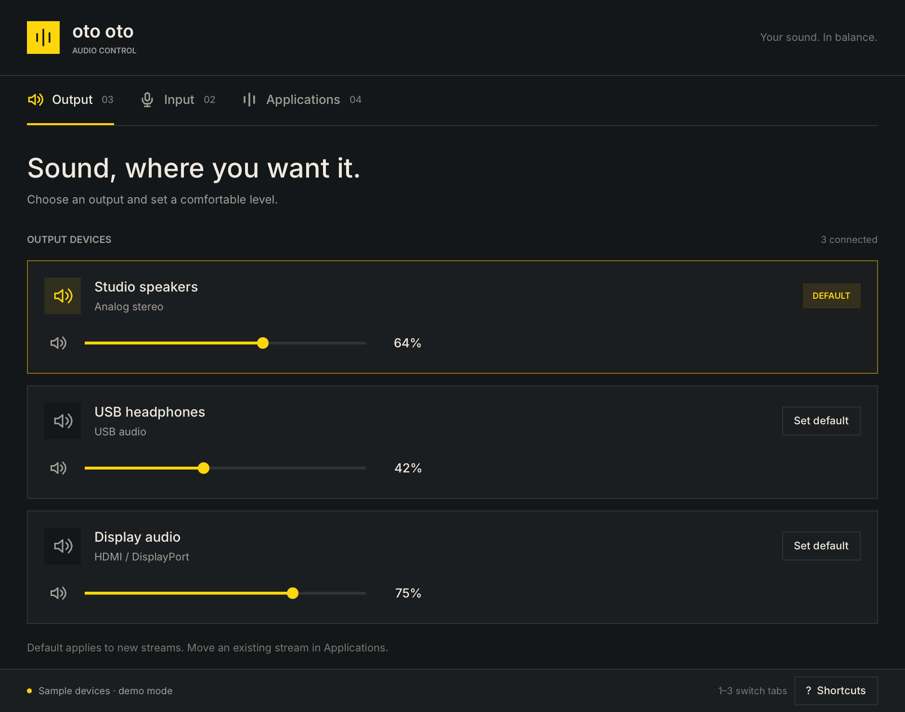

# Oto Oto



A native Linux audio mixer in Rust, built with [Anomaly's Rune](https://github.com/anomalyco/rune). Choose outputs and microphones, adjust device and per-stream volume, mute, change ports, and route playing or recording apps to another device.

Works with PipeWire through `pipewire-pulse`, or with PulseAudio. Uses `pactl` JSON; it does not edit audio configuration files. New devices, streams, and external volume changes appear within two seconds. Audio commands run off the UI thread and report failures in the window.

## Build and run

Install a current stable Rust toolchain, the Wayland and XKB libraries, a Vulkan driver, and `pactl`:

```sh
# Arch / Omarchy (with an existing working PipeWire setup)
sudo pacman -S --needed rust git pkgconf wayland libxkbcommon libxkbcommon-x11 libpulse

# Debian / Ubuntu (with an existing working audio server)
sudo apt install build-essential git pkg-config libwayland-dev libxkbcommon-dev libxkbcommon-x11-0 mesa-vulkan-drivers pulseaudio-utils

bin/build
./target/release/oto-oto
```

Rune is pre-release and pinned to a specific commit; `Cargo.lock` pins transitive dependencies. First builds download and compile the renderer and can take several minutes. Wayland and X11 are supported. The app needs a working Vulkan driver (hardware or Mesa software rendering).

Install the binary, icon, and launcher entry for the current user:

```sh
bin/install
```

Open **Oto Oto** from the desktop launcher, or run `~/.local/bin/oto-oto`. `PREFIX` overrides the default `~/.local` install location. For an Arch package, run `bin/package` from the project root, then install the resulting package with `pacman -U`.

On Omarchy the accent follows the current theme within two seconds, including theme symlink replacements. On other desktops it defaults to yellow. No desktop settings are changed.

## Controls

| Key | Action |
| --- | --- |
| `1`, `2`, `3` | Output, Input, Applications |
| `M` / `Space` | Mute the default output (or input on the Input tab) |
| `+`, `-` | Adjust the default volume by 5% |
| `Tab`, `Shift+Tab` | Move focus |
| Arrows / Home / End | Adjust a focused slider |
| `R` | Refresh / reconnect |
| `?` / `Escape` | Show / close shortcuts |
| `Q` | Quit |

Volume controls range from 0–100%; existing amplification above 100% is displayed, but new changes are capped at 100%. A dragged volume is applied on release; Escape cancels the drag. Setting a default changes the device for new streams. Use Applications to move existing streams. Monitor sources are hidden from microphone devices. Each application stream gets its own controls, so an app with several streams can appear more than once.

Device port menus appear when a device has several usable ports. Card profile changes, equalizers, Bluetooth pairing, and live signal metering are outside this version's scope. Interface text is currently English.

## Inspect and verify

```sh
./target/release/oto-oto status             # Real audio state as JSON; no display needed
./target/release/oto-oto --demo             # Interactive sample devices; no audio changes
./target/release/oto-oto --snap docs/output.png
./target/release/oto-oto --scene apps --snap docs/apps.png
bin/test
```

Rune's headless rendering and scripted input automatically use isolated sample devices and never run audio commands. Scenes include `output`, `input`, `apps`, `empty`, and `error`. Tests exercise JSON parsing, command argument construction, controls, routing, drag cancellation, and stale backend updates.

If the app cannot connect, verify that `pactl info` works in the same user session and that PipeWire's PulseAudio service or PulseAudio is running. Errors stay visible until dismissed; Retry requests a fresh snapshot.
